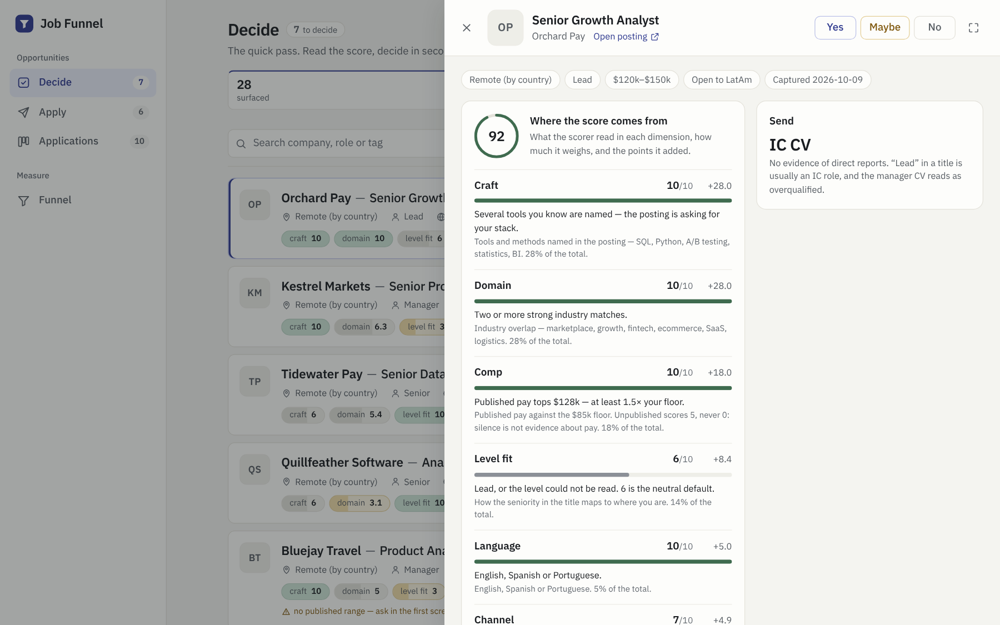
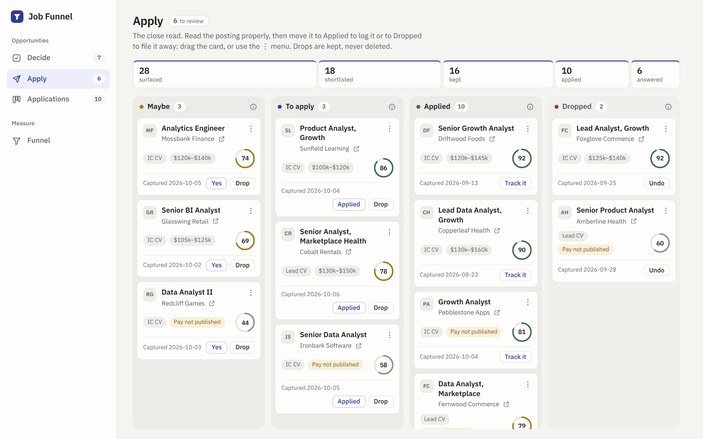
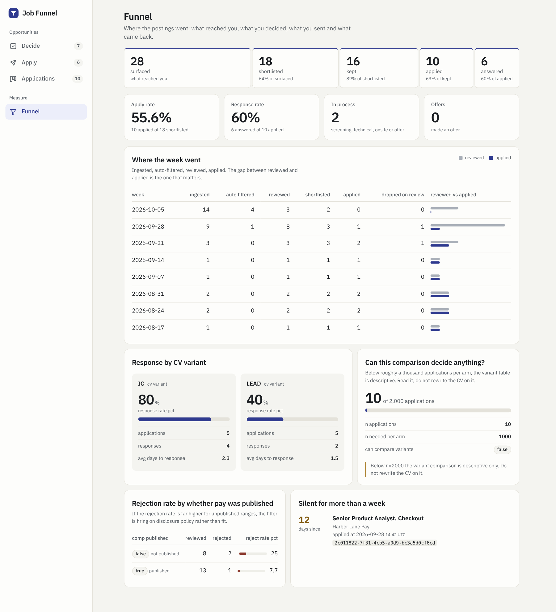

# Job Funnel

A personal job-search pipeline that finds remote data roles every weekday, filters out the ones I can't or shouldn't take, scores the rest, and turns my decisions into a measurable funnel. I built it to fix a real bottleneck in my own search and to teach myself the parts of software engineering my analytics work doesn't usually touch: APIs, a web front end, CI/CD, scheduled jobs and a cloud database.

> **About this repo.** This is the public copy of the project. The code is the same one I run every day; my real search (profile, applications, companies) lives in a private repo. Here, every company, posting and application is **fictional demo data**, so you can run the whole app locally and see it working.

**In practice:** I went from reviewing 11–15 saved roles a week in about 4 hours (even with Claude helping) to a pool of 30–35 roles a week that I review in 30–60 minutes.

**Read the case study:** [`reports/memo.md`](reports/memo.md) **Read what broke and what I learned:** [`reports/engineering.md`](reports/engineering.md) **Every judgment call:** [`decisions.md`](decisions.md)

Screenshots taken from the demo data:




## The problem

Finding openings was never the hard part. Evaluating them was. Most "remote" roles quietly require living in the US, many come through staffing agencies, and a lot of them don't publish pay. I was reading every posting top to bottom just to find out it was a no. The judgment calls were fast; the reading was what exhausted me before I applied to anything.

So the design goal was simple: **let the machine do the reading that ends in an obvious no, and save my attention for the decisions that actually need me.**

## How it works

The pipeline is three filters, each more expensive than the one before it:

| Filter | Who | What happens | Cost |
|---|---|---|---|
| 1. Rules + score | Automated | Drops staffing agencies, onsite roles, pay below my floor, country-restricted roles and roles outside my target families. Scores everything that survives. | Zero |
| 2. Decide | Me, quick pass | A scrolling list of scored postings. I open one for the detail and decide yes / maybe / no with one keystroke (or one tap on my phone). | Seconds per role |
| 3. Close read | Me, slow pass | The yeses and maybes get read properly, then I apply or drop. Drops are archived, never deleted. | Minutes per role |

In my private instance, every weekday at 08:00, a GitHub Actions workflow pulls new postings from 7 configured sources across three public APIs (Greenhouse company boards, Remotive and Jobgether), runs them through the pipeline, and writes them to a Postgres database in the cloud. Roles from LinkedIn and other sites that block automation come in through a paste box.

```
 GitHub Actions (weekday cron)          me
          │                              │
          ▼                              ▼
  ┌───────────────┐   ┌─────────────┐   ┌──────────────┐   ┌──────────────┐
  │ 7 sources     │──▶│ rules gate  │──▶│ Decide       │──▶│ close read   │──▶ applied / dropped
  │ + paste box   │   │ + scorer    │   │ yes/maybe/no │   │ apply / drop │        │
  └───────────────┘   └─────────────┘   └──────────────┘   └──────────────┘        ▼
                                                                         funnel + follow-ups
```

### The score

Each posting gets a 0–100 fit score from six dimensions with explicit weights. No model, no API key, no cost. Every point traces back to a matched keyword or a parsed field, so I can always see *why* a role scored what it did.

| Dimension | Weight | What it reads |
|---|---|---|
| Domain | 28% | Industry and problem-space keywords |
| Craft | 28% | Tools and methods (SQL, experimentation, BI, Python...) |
| Comp | 18% | Published pay, normalized to USD per year |
| Level fit | 14% | Seniority read from the title and text |
| Channel | 7% | Product company vs. agency, consultancy or staffing |
| Language | 5% | English, Spanish, Portuguese |

Alongside the score, each posting lists the **gaps to prepare**: requirements I don't fully meet, each quoted from the posting itself, so I know what to address before applying.

The score is for sorting and discarding, not for deciding. The decision stays with me, and my yes / maybe / no labels are written only by a person, never by the system, so they can be used to measure the scorer later.

## What's here

| Path | What it does |
|---|---|
| `api/app/ingest/` | One adapter per source (Greenhouse, Remotive, Jobgether, paste). Each returns the same shape. |
| `api/app/rules/filters.py` | The rules gate: staffing, remote, pay floor, language, target role families, geography, thin-listing flag |
| `api/app/free/` | Extraction (pay, seniority, geography, tags) and the weighted scorer |
| `api/app/pipeline.py` | Ingest → dedupe by content hash → rules → score → store |
| `api/app/routers/` | FastAPI endpoints for opportunities, applications and analytics |
| `api/app/cli.py` | `pull-all` (what the cron runs), `boards`, `backfill`, `nudge`, `metrics` |
| `api/db/schema.sql` | Postgres schema. Applications are event-sourced: one row per stage change, never an update. |
| `api/db/views.sql` | The metric layer: funnel, effort leak, application state, follow-ups |
| `api/db/zz_demo_data.sql` | Fictional demo data, generated by running invented postings through the real pipeline |
| `api/app/profile.md` | The candidate profile the scorer judges fit against (a fictional one here) |
| `api/tests/` | 100+ unit tests, all runnable without a database |
| `web/` | Next.js front end: Decide (a scored list with a detail panel), Apply and Applications (kanban boards), Funnel |
| `.github/workflows/pull.yml` | The weekday search: cron + secrets + run summary |
| `.github/workflows/ci.yml` | Runs the tests on every push |

## Stack

Python 3.12 · FastAPI · SQLAlchemy 2.0 · Postgres 16 (Neon free tier) · Next.js 15 · Docker Compose · GitHub Actions · pytest

## Running it locally

You need [Docker Desktop](https://www.docker.com/products/docker-desktop/) and [Node.js](https://nodejs.org/).

```bash
cp api/.env.example api/.env          # defaults work as is with docker compose
docker compose up -d                  # Postgres + API on :8000 (docs at /docs)
cd web && npm install && npm run dev  # the app on :3000
```

Open `http://localhost:3000/triage`. On first start the database loads the demo data automatically: a list of postings waiting for a decision, an Apply board, applications at different stages and a funnel with history. Dates are relative to today, so the demo never looks stale.

Run the tests (no database needed):

```bash
docker compose exec api python -m pytest tests/ -q
```

Run a real search against the public APIs:

```bash
docker compose exec api python -m app.cli pull-all
```

To start over with a clean database: `docker compose down -v` and `docker compose up -d` again.

### Running the daily search on GitHub

The workflow in `.github/workflows/pull.yml` is **off by default** here, because this repo has no database attached. To turn it on in your own copy, add a `DATABASE_URL` secret (for example a free Neon Postgres) and a repository variable `DAILY_PULL` set to `true`. It can also be triggered by hand from the Actions tab.

## What this project can and can't claim

- **The time savings are my own measurement, not a controlled study.** They compare my weekly routine before and after, over the same kind of search.
- **The score sorts; it doesn't judge.** It's built from keywords, so it misses nuance in oddly written postings. Roles from Jobgether arrive without a description, so their scores are partial and the app flags them as such.
- **The funnel can't tell me which CV works better.** At my volume, a fair comparison of two CV versions would need on the order of a thousand applications per version. The funnel is useful for spotting leaks (roles I liked but never applied to), not for A/B conclusions.
- **It's single-user by design.** No login, no multi-tenancy. That's a deliberate scope choice for a portfolio project, not an oversight.

## Next

More sources (Ashby and Lever company boards, Himalayas), more keyword queries for BI and data science roles, and a measured check of the scorer against my own labels.
